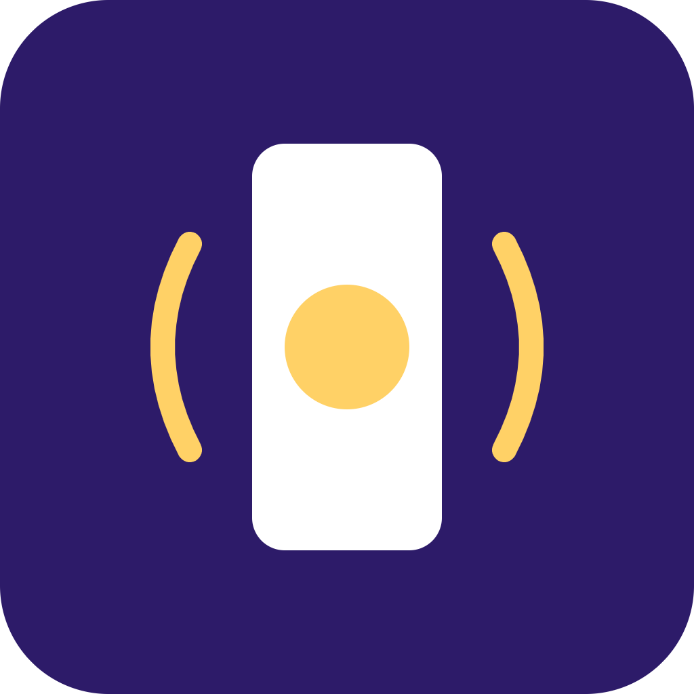

# RiseStake


**Stake crypto, shake your phone for 60 seconds, wake up or lose it.**

## Overview

RiseStake is a mobile alarm app built for the Colosseum hackathon that turns waking up into a real commitment. Before going to sleep, users stake SOL. To silence the alarm, they must complete a 60-second physical micro-challenge detected by their phone's sensors. Succeed, and they get their stake back plus a share of stakes forfeited by people who failed. Fail, and the stake goes into the daily winners' pool.

## Problem

Traditional alarms are too easy to snooze and dismiss. A single tap turns off the sound without requiring any real proof that the user is actually awake, so people keep oversleeping with zero consequences.

## Solution

RiseStake combines a short, intense physical challenge with real financial stakes recorded on-chain. Users put SOL on the line before sleeping, and only a genuine burst of physical activity, verified by the phone's accelerometer, can disarm the alarm and return their stake.

## Features (MVP)

- Pre-sleep SOL staking via wallet connect
- Accelerometer-based 1-minute shake/squat mini-game to disarm the alarm
- Smart contract pool: failed stakes redistributed to successful wakers each day
- On-chain streak tracking and daily leaderboard
- Push notification plus anti-cheat check (motion pattern validation)

## Tech Stack

- React Native (mobile app)
- Solana web3.js and Anchor (on-chain program and client integration)
- Phone accelerometer API (motion detection)
- Supabase (off-chain motion logs)
- Solana Pay (staking payments)

## How It Works

```
[User] --stake SOL (Solana Pay)--> [Anchor Program / Stake Pool]
   |
   | sleeps, alarm fires at wake time
   v
[Phone Accelerometer] --60s shake/squat--> [Motion Validation]
   |                                            |
   | success                                failure
   v                                            v
[Stake returned + share of pool]      [Stake forfeited to pool]
   |
   v
[On-chain streak + leaderboard update]
```

Motion samples are logged off-chain in Supabase for debugging and anti-cheat analysis, while final success/fail results, stake movements, and streaks are recorded on-chain via the Anchor program.

## Roadmap

- Anti-spoofing ML model for stronger motion verification
- Squad/group staking mode
- Partnerships with fitness and insurance apps for streak-based perks

## Pitch

- Full pitch deck: [docs/pitch.pdf](docs/pitch.pdf)
- Spoken pitch script: [docs/pitch-script.md](docs/pitch-script.md)

## Team

- [Name] – Role (e.g. Smart Contracts / Anchor)
- [Name] – Role (e.g. Mobile / React Native)
- [Name] – Role (e.g. Product / Design)

---

🎬 Pitch video: [docs/pitch-video.mp4](docs/pitch-video.mp4)


## Prototype

Live prototype: https://aa-to-cc.github.io/risestake/

The source is [docs/index.html](docs/index.html) (served with GitHub Pages from the /docs folder). All data is simulated.
